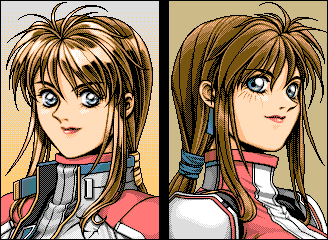

> 🌐 **English** · [Українська](ADVANCED_PD2.uk.md)

# Advanced Power Dolls 2 (1996) — the `.fdd` images

## 1. What this release is

Advanced PD2 is **not a standalone game but a patch/expansion over the base
Power Dolls 2**. Evidence from the disks themselves (disk 2 carries a text
makefile next to the installer fragments):

```
.SILENT
.SUFFIXES : .idx .bnd .org .chg
pd2dt.idx : MES2.PCK WMES2.PCK INIT2.PCK NPC2.PCK SMAP1.PCK \
            DATAU.PCK MUNIT.PCK TUNIT.PCK WEAPON.PCK MMAP1.PCK \
            CHARA.PCK FACE.PCK DFACE.PCK EVKAO.PCK MAP_CHG.PCK \
            MISSONSD.PCK MISSONMD.PCK MISSONHD.PCK MISSONPD.PCK MISSONCD.PCK \
            EVENT.PCK ARMS.PCK SCORE_N.PCK \
```

The installer **assembles** new files from an existing PD2 installation using
`.org`/`.chg`/`.idx`/`.bnd` rules. Files on the disks carry the base game's names
(`PD2SHELL.EXE`, `TACTICS1.EXE`, …) but their content is patch/fragment data, not
finished executables (only `GO.EXE`, `BRIEF2.EXE`, `BRIEF3.EXE` start with `MZ`).

## 2. The `.fdd` layout (no BPB — recovered from the data)

| item | value |
|---|---|
| directory | `0xD7FC`, 192 entries of 32 bytes |
| first cluster | `+0x1A` (u16), size | `+0x1C` (u32) |
| data area | `0xEFFC`, cluster **1024** bytes, `spc=1` |
| contiguity | every file is contiguous: `cluster[k+1] = cluster[k] + ceil(size/1024)` (17/17 pairs verified on disk 1) |
| quirk | the image **lacks the disk's first 4 bytes** (the real boot sector would start at `-4`); on disks 4–8 a copy of it sits at `0xC3FC` |
| sizes | 1,092,604 / 763,900 / 765,948 / 1,311,740 ×5 / 1,038,332 bytes |

There is no BPB at all (the first sector is `VFD1.00` plus zeros), so
`tools/img_extract.py` gained a "FAT without a BPB" detector: it finds the
directory, then picks the entry count (16…256) and cluster size from the
**contiguity of the files**, from `.EXE` entries really starting with `MZ`, and
from the data filling the image to its end.

Control checks: `GO.EXE` (disk 1) = `MZ`, `BRIEF2.EXE` (disk 2) = `MZ`,
`PD2DT.000…005` = `BI` ("BIGFILE") — all consistent.

## 3. What is on the disks

| disk | contents |
|---|---|
| 1 | installer and first modules: `INST.EXE`, `HD_INST.SCR`, `GO.EXE` (a real EXE), `PD2SHELL.EXE`, `CONVERT.EXE`, `BRIEFING.EXE`, `TACTICS1.EXE`, `STARTUP.EXE`, `CONTROL.EXE`, `MAKEINIT.EXE`, `REPORT.EXE`, `KABE3.GCP`, `FONT_ANK.DAT`, `EMI/NARU/SARI/CDP.COM` |
| 2 | `BRIEF2.EXE` (MZ), `TACTICS2.EXE`, `REPORT2.EXE`, `PD2DT.IDX`, `OPENING.EXE` |
| 3 | `BRIEF3.EXE` (MZ), `TACTICS3.EXE`, `REPORT3.EXE`, `UNINST.EXE`, `DFACE2.PCK`, `COMMENT.TXT` |
| 4–8 | one container volume each: `PD2DT.000` … `PD2DT.004` (1,250,304 bytes each) |
| 9 | `PD2DT.005` (976,796 bytes) |

`PD2DT.000…005` are six parts of **one logical container** `BIGFILE`
(7,228,316 bytes) holding the bundle `PD2DT.BND`.

## 4. `PD2DT.BND` — solved: a plain bundle + a 24-byte member table

Advanced PD2 does not ship the game's data files. It ships **one bundle** plus a
**table of contents**, and the pair is now decoded:

```
PD2DT.IDX   a flat array of 24-byte records, no header
    +0..15   member name, NUL padded (ASCII, no path)
    +16..19  member size,   u32 little endian
    +20..23  member offset inside the .BND, u32 little endian

PD2DT.BND   the raw concatenation the table describes
```

`169` records, and the layout is **exact**: `offset[k] + size[k] == offset[k+1]`
for every k, and the last member ends on the bundle's last byte
(7,228,225 of 7,228,225). No compression, no header, no padding. The table is
also self-checking — a wrong stride, field order or endianness shows up at once
as a gap, an overlap or a run past the end.

Earlier work looked for the member table *inside* the bundle and found the
`BIGFILE` / `PD2DT   BND` strings there. They belong to the installer's own data,
which is just another member (`SAVEDATA.ORG`, `MAKEFILE`, `PD2DT.IDX` is
regenerated on install), which is why the container resisted.

```
python pd2bnd.py --idx PD2_3/PD2DT.IDX --bnd PD2_3/PD2DT.BND -o out/apd2
python pd2sweep.py --image APD2.hdi -o out/apd2-sweep     # does it automatically
```

| what the 169 members are | count |
|---|---|
| `.PCK` archives | 74 |
| `.GCP` display lists | 39 |
| `.ASK` pictures | 9 |
| `.SLD` raw blocks | 6 |
| `.DAT`, `.CMD`, `.MID`, `.CFG` | 37 |
| `MAKEFILE`, `TIMECHK`, `SAVEDATA.ORG/TMP` | 4 |

That is the whole game data set: `CHARA`, `FACE`, `DFACE`, `EVKAO`, `ARMS`,
`WEAPON`, the `M_CLR*`/`AMAP*`/`SMAP*`/`MMAP*`/`OP3MAI_*`/`ADOPWI_*`/`OP_PL*`
sets, the `MISSON*`/`SCORE_*` archives, every `KABE*`/`K_BLANC*`/`BUSOU_*`/
`PLAN_*` display list — plus **Advanced-only screens** that exist in no other
release: `GAMEOVER.GCP`, `SINGLE.GCP`, `M_FAIL.GCP`, `AD_END.PCK`, `APD_STF0..3`,
`KOKUPI3/4`, `0OPHA3`, `OPHUAN3`, `AMAP1..3`. With the bundle split, sweeping an
`APD2.hdi` finds **546 pictures** instead of the two containers sitting loose on
the disc.


## 4a. Advanced PD2 also changed the portrait format

In the base game `CHARA.PCK` holds 38 display-list blocks
([`DISPLAYLIST.md`](DISPLAYLIST.md)). In the bundle the same 38 slots hold
**plain rasters** — `u32 size; u16 x,y,w,h` gives `19200 = 160*240/2` with `x,y`
the placement on the 640x400 screen (`0`, `160`, `320`, `480`), i.e. four portraits
per screen row. 27 of the 38 slots are pictures in both releases.

The art is not the same art, so the two are complementary sources rather than a
cross-check:



## 5. Open items

1. **The `.org`/`.chg` patch rules.** `PD2DT.IDX` is the *result* of the
   installer's `.idx : .bnd .org .chg` rule; the bundle is therefore already the
   assembled payload, and `pd2bnd.py` gets it without knowing the patch
   semantics. Decoding `.org`/`.chg` would only matter for reproducing the
   install byte for byte.
2. **How the discs split the bundle.** The `.fdd` set carries `PD2DT.000…005`
   (7,228,316 bytes in total) while the HDI release ships one `PD2DT.BND`
   (7,228,225). Both use the same 24-byte table layout; the 91-byte difference
   between the two builds is unexplained.
