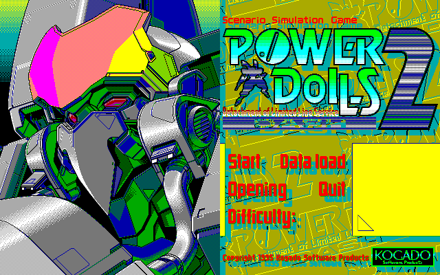
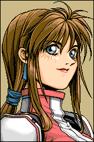

> 🌐 **Українська** · [English](DISPLAYLIST.md)

# Display-list'и `.GCP` / `CHARA.PCK` — розв'язано

Display-list'и **декодуються**. Кожен блок із гри доходить до останнього байта й
рендериться як картинка; витягувач — `pd2gcp.py`.

| | |
|---|---|
| `.GCP` (PD1: 24 файли, PD2: 26 файлів) | ✅ рендеряться в PNG |
| `CHARA.PCK` (27 із 38 записів) | ✅ рендеряться в PNG |
| Граматика потоку | ✅ відновлена, байт-у-байт (`used == len(stream)` на всіх 77 блоках) |
| Палітри | ✅ 32-байтова пакована таблиця на `+0xB`; `.GCP` PD1 її не мають (беруть з EXE) |
| Записи `CHARA.PCK` 27..37 | не растр і не display-list — досі не конвертуються |
| Гілка Хаффмана в читачі байтів | код є, але **мертвий для цих даних** (див. §7) |

```
python pd2gcp.py --gcp hdi/PD2D/KOGADO.GCP out
python pd2gcp.py --pck hdi/PD2D/CHARA.PCK out --entry 0
python pd2gcp.py --all hdi/PD2D out
python pd2gcp.py --all "power dolls 1/_unpacked" out --pal-exe "power dolls 1/_unpacked/PREMIUM.EXE:0xEDF1"
```



## 1. Що таке блок

```
+0      прапорці
          біт 0x40  потік збережено «як є»
          біт 0x80  режим GRCG read-modify-write (XOR)
          біти 0x30 0 = звичайне малювання; інакше виконується заливка рядків,
                    а потім прохід декодування XOR по рядках — (flags & 0x30) >> 4 разів
          біти 0x0F маска площин GRCG: встановлений біт означає, що площина НЕ
                    записується, тож у потоці байти тайла є лише для тих площин,
                    у яких біт знято
+1      ширина в байтах — протяжність рядка для заливки й XOR-проходу
+2..3   висота в рядках (16-біт LE)
+4..7   початковий тайл GRCG: по байту на записувану площину, порядок B,R,G,E
+8      зсув даних від +9; >= 0x22 означає «32-байтова палітра на +0xB,
        а потік починається після неї»
+9..10  16-бітний зсув у VRAM; завантажувач бере його замість переданого
        пера, коли пер >= 0x7D00
+0xB..  16-колірна пакована палітра, коли +8 >= 0x22:
        byte[2i] = (index << 4) | R,  byte[2i+1] = (G << 4) | B
потік   блок + 9 + блок[8]
```

`ширина x 8` — це ширина картинки в пікселях, `висота` — її висота: записи
`CHARA.PCK` — це `20 x 240`, тобто **портрети 160x240**, `KOGADO.GCP` — `24 x 56`,
`PD2TITLE.GCP` — `80 x 400`, тобто повний екран. Ніяких здогадів і пошуку
вирівнювання — геометрія лежить у заголовку.

## 2. Завантажувач — `CONVERT.EXE` образ `0x5DE5`

```c
void gcp_load(struct block *b, unsigned pen, int load_palette) {
    unsigned mask  = ~b->flags & 0x0F;       /* площини, які ТАК записуються */
    unsigned width = b->width, height = b->height;

    if (b->payload >= 2 && pen >= 0x7D00)    /* блок перекриває пер */
        pen = b->vram_offset;

    out(0x7C, (b->flags & 0x0F) | 0x80);     /* GRCG увімкнено, маска площин */
    for (i = 0; i < 4; i++)                  /* початковий тайл GRCG */
        out(0x7E, (mask & (1 << i)) ? b->tile[read++] : 0);

    if (b->flags & 0x30)                     /* заливка кожного рядка */
        for (r = 0; r < height; r++)
            fill(0xA800, pen + r * 0x50, b->width, 0);   /* пише тайл */

    player(b, pen, popcount(mask));          /* §4: потік команд */

    n = (b->flags & 0x30) >> 4;              /* §5: декодування XOR по рядках */
    while (n--)
        for (r = 0; r < height - 1; r++)
            for (p = 0; p < 4; p++)
                if (mask & (1 << p))
                    xor_row(0xA800 + p * 0x800, pen + r * 0x50, b->width);

    if (b->payload >= 0x22 && load_palette)  /* 16 кольорів у порти */
        for (i = 0; i < 16; i++) { ... out(0xA8/0xAA/0xAC/0xAE, nibbles); }
}
```

`xor_row(seg, off, n)` — це `площина[off + 0x50 .. +n] ^= площина[off .. +n]`:
він складає один 80-байтовий рядок VRAM у наступний.

Гравців два, вибір — за байтом заголовка:

| гравець | образ | коли використовується |
|---|---|---|
| A | `0x5FCD` | `(flags & 0x70) != 0x40` |
| B | `0x63E3` | `(flags & 0x70) == 0x40` |

Різниця лише в тому, як вони беруть байти потоку: A — через читач байтів
`0x6213`, B — напряму з блоку. Оскільки прапорець `0x40` встановлено в
**кожному** блокі з гри (а читач за цим прапорцем повертає байти «як є»), обидва
гравці на цих даних поводяться однаково.

Адреси гравців: PD2 `CONVERT.EXE 0x5FCD`, `STARTUP.EXE 0x608F`,
`TACTICS.EXE 0xC33F`, `BRIEFING.EXE 0x10AA1`, `OPENING.EXE 0x5D90`,
`REPORT.EXE 0x802B`, `CHOICE.EXE 0x670C`, `PD2SHELL.EXE 0x5AF0`;
PD1 `PREMIUM.EXE 0x63E8`, `STARTUP.EXE 0x5230`. (`MAKEINIT.EXE` та `GO.EXE` —
інші збірки, там рутини немає.)

## 3. До чого тут порти `0x7C` / `0x7E`

Це не µPD7220, а **GRCG** (Graphic Charger) PC-98:

* `0x7C` — регістр режиму: біт 7 вмикає GRCG, біт 6 обирає режим
  read-modify-write, біти 0..3 — маска площин, причому **встановлений** біт
  означає *відсутність доступу* до площини. Саме тому в потоці байти тайла є
  лише для тих площин, де біт **знято** (`mask = ~flags & 0x0F`).
* `0x7E` — чотири регістри тайла, по байту на площину в порядку **B, R, G, E**
  (той самий порядок, що й у растровому кодеку).

Коли GRCG увімкнено, **байт, який процесор записує у GVRAM, не має значення**:
апаратура підставляє замість нього тайл. Тож `stosb` — це лише *курoк*, який
ставить вісім пікселів, а значення, яке гра в нього кладе, — довільне (у
XOR-режимі це OR різниць між вхідним тайлом і початковим — прапорець «чи щось
змінилося»). Саме це пояснює, чому попередня модель, яка читала ці значення
`stosb` як кольори, ніколи не могла збігтися з VRAM.

## 4. Потік команд

Потік починається одним тайлом (по байту на записувану площину, чотири для
звичайної картинки). Далі, до другого `0x7F`:

| байт | значення |
|---|---|
| `< 0x7D` | `skip = (c << 8) \| next`, потім один відбиток |
| `0x80..0xFD` | `skip = c - 0x80`, потім один відбиток |
| `0x7D` | `count = ((d << 8) \| next) + 2`, або `(d - 0x80) + 2` коли `d >= 0x80`; відбити поточний тайл `count` разів |
| `0x7E` | пер = база, і прочитати новий тайл |
| `0x7F` | пер = база; перший перемикає на другий прохід, другий завершує блок |

**Відбиток** пише поточний тайл за поточним зсувом у VRAM — по байту на
записувану площину, вісім пікселів — і зсуває зсув на одиницю. Зсув — це просто
байтовий зсув у площині VRAM, тож рядок екрана — 80 байтів, а `skip` у `0x50`
опускає рівно на рядок.

У другому проході кожен відбиток спершу бере новий тайл із потоку, тому потік
природно ділиться на «кілька тайлів, відбитих довгими серіями» та «растр».

`0x7F` — це ще й те, що робить модель перевірюваною: гравець мусить улучити в
закривний `0x7F` рівно тоді, коли в блоці закінчуються байти. Так роблять усі
**77** блоків із гри — той самий аргумент «спожито до останнього байта», яким
перевірено растровий кодек.

## 5. Прохід XOR по рядках: потік — це *дельта*-картинка по рядках

Якщо зупинитися після §4, картинка виглядає як кольорова графіка з контурів:
[лише дизеровані обриси](img/gcp_delta_vs_xor.png) (ліворуч). Це не малюнок — це
кодування.

Художник зберігав кожен рядок як **XOR-різницю** з рядком вище, а завантажувач
інтегрує її назад:

```c
for (r = 0; r < height - 1; r++)
    plane[pen + (r+1)*0x50 ..][0 .. width] ^= plane[pen + r*0x50 ..][0 .. width];
```

Прохід виконується `(flags & 0x30) >> 4` разів — один для звичайних екранів
(`0x50`), два для тих, що ще й грають розчинення (`0x60`). Після проходу той
самий блок — повноцінна ілюстрація:



Це також пояснює давнє спостереження, що «`.GCP` PD1 не несуть палітри»: щоб
зберегти *маску*, вона не потрібна, а кольори екранів беруться з 48-байтових
таблиць усередині EXE (`pd2pal.py --exe`, `docs/PALETTE_TABLES.md`).

## 6. Палітри

32-байтова таблиця на `+0xB` — це пакована форма рутини
(`byte[2i] = (index << 4) | R`, `byte[2i+1] = (G << 4) | B`). Вона самooписова:
старший напівбайт другого байта — це індекс, якому він належить, тож
`pd2pal.palette_from_packed()` відкидає все, що не є такою таблицею.

Мати таблицю — не те саме, що *бути нею намальованим*, і тут два різні випадки:

* **`.GCP` PD1** мають `+8 == 0`, тобто таблиці немає взагалі. Кольори екранів
  беруться з 48-байтових банків усередині EXE; `--pal-exe PREMIUM.EXE:0xEDF1` —
  добра відправна точка для портретів.
* **`.GCP` PD2** таблицю несуть, і більшість несе стандартну гаму (`HARDY.GCP`,
  `KOGADO.GCP` — дві власні). Саме вбудовану таблицю `pd2gcp.py` бере за
  замовчуванням.
* Записи **`CHARA.PCK`** несуть на `+0xB` *стандартну гаму*, але екрани
  портретів малюються спільною палітрою малюнків
  (`BRIEFING.EXE 0x234C6`). Порівняйте:

  ```
  python pd2gcp.py --pck hdi/PD2D/CHARA.PCK out --entry 0
  python pd2gcp.py --pck hdi/PD2D/CHARA.PCK out --entry 0 --pal-exe hdi/PD2D/BRIEFING.EXE:0x234C6
  ```

  Перший запуск дає портрет у стандартній гамі, другий — оригінальний малюнок.

Підписи до зображень вище використовують палітру малюнків для `CHARA.PCK` і
власну таблицю файлу в інших випадках. `pd2pal.py --suggest` впорядковує
кандидатів для заданого активу; див. [`PALETTE.md`](PALETTE.uk.md) і
[`PALETTE_TABLES.md`](PALETTE_TABLES.uk.md).

Замість того щоб міркувати, яка таблиця якому екрану належить, — переберіть:
`pd2sweep.py` рендерить кожну знайдену картинку кожною знайденою палітрою й пише
по одному підписаному контактному аркушу на картинку. Для даних HDI це 33 аркуші
для 26 `.GCP` і 27 блоків `CHARA.PCK`.

```
python pd2sweep.py --data hdi/PD2D -o out/sweep
python pd2sweep.py --data hdi/PD2D -o out/sweep --orders all   # ще й усі перестановки каналів
```

## 7. Мертва гілка Хаффмана

Читач байтів `0x6213` має два режими. Коли встановлено прапорець `0x40`, він
повертає черговий байт із блоку (`lodsb`); інакше він іде 256-символьним деревом
Хаффмана, яке рекурсивний будівник `0x6306` вичитує з потоку (`1` — внутрішній
вузол, рекурсія двічі; `0` — листок, наступні 8 біт).

Цей будівник кладе «1»-нащадків у `DGROUP:0x955E`, а «0»-нащадків — у
`DGROUP:0x935E`, тоді як читач шукає «1»-нащадків у `DGROUP:0x915E`. Таблиця
`0x915E` — це BSS, і її не пише ніщо в жодній збірці (усі три копії
`CONVERT.EXE` згодні), тож стиснений шлях декодував би кожну «1»-гілку як
символ 0. Жоден `.GCP` чи запис `CHARA.PCK` із гри туди не заходить: у всіх
встановлено прапорець `0x40`. Гілка мертва — і саме тому попередню «граматику»
`0x7D/0x7E/0x7F` можна було прочитати просто з сирих байтів.

## 8. Перевірка

* **Структурна.** Усі 77 display-list'ів (24 `.GCP` PD1, 26 `.GCP` PD2, 27
  записів `CHARA.PCK`) споживають свій потік до закривного `0x7F`; перевірки
  `[8]` і `[9]` у `tools/verify.py` це фіксують, а також геометрію з заголовка
  для чотирьох блоків.
* **Змістова.** Результат — не шум: `PD2TITLE.GCP` — титульний екран із меню,
  `SPRE00.GCP` — екран епілогу з текстом (правильні обриси кани), записи
  `CHARA.PCK` — портрети 160x240, а `ELIOLA.GCP` — повна ілюстрація, на якій
  читається ім'я персонажа.
* **Незалежний шлях.** У `K_BLANC1.GCP`, `KOGADO.GCP` і `PLAN_GB/GC.GCP`
  `flags & 0x30 == 0`, тож вони проходять гравця *без* XOR-проходу; повноекранний
  `SPRE00.GCP` так рендериться правильно.
* **Палітра.** 32-байтові паковані таблиці декодуються в ті самі 16 кольорів,
  які рутина запису палітри віддає в порти `0xA8/0xAA/0xAC/0xAE`, — а це вже
  перевірено в `pd2pal.py` проти живих дампів.

## 9. Що лишилося

* Записи `CHARA.PCK` 27..37 — не display-list'и (11 записів). Вони не
  закінчуються на `0x7F` і не декодуються; їхня роль досі відкрита.
* `ANIME.PCK`, `EVENT.PCK`, `INIT.PCK`, `MAP_CHG.PCK`, `MES.PCK`, `MOJI.PCK`,
  `NPC.PCK`, `MUNIT.PCK`, `TUNIT.PCK`, `NAMES.PCK`, `SCORE_N/SCORE_P.PCK`,
  `OP_*.PCK`, `YAOUPD1.PCK`, набір `MISSON*.PCK`: не растр і не display-list.
  Текст, таблиці та ще не ідентифіковані дані.
* Палітри `.GCP` PD1 досі підбираються вручну (`--pal-exe`); гра обирає одну з 40
  таблиць у `PREMIUM.EXE` для кожного екрана під час виконання.
