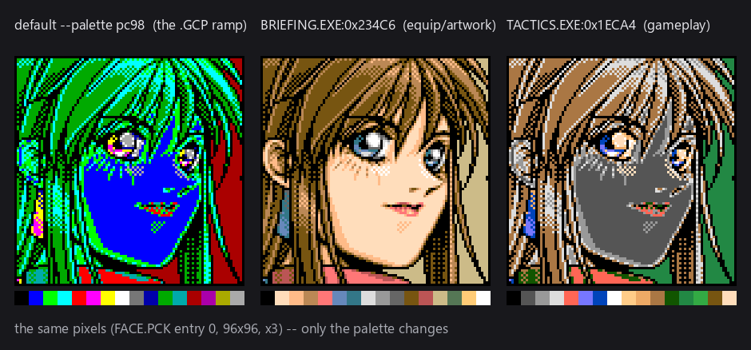

> 🌐 **English** · [Українська](PALETTE.uk.md)

# The Power Dolls 2 (PC-98) palette

## ⚠️ Read first: the default palette is not the artwork screen palette

`pd2extract.py` renders with the **PC-98 default palette** unless you pass `--pal`
or `--pal-exe` — the ramp packed into 24 of the 26 `.GCP` files. It is a real
palette, but it is **not the palette the game puts on screen for its artwork**. A
plain `--all` run therefore writes PNGs whose colours are wrong, and it is very
easy to blame the codec for that for a whole day.



*The same picture (`FACE.PCK` entry 0), three palettes. Left: the default. Middle:
the table the equip/artwork screens really use. Right: another table the game really
uses (gameplay) — it looks plausible too, but it is not this screen's.*

*Reproduce the panels with `python pd2extract.py --pck FACE.PCK out\x --pal-exe
BRIEFING.EXE:0x234C6` (and the same run with `--palette pc98`, or with
`--pal-exe TACTICS.EXE:0x1ECA4`).*

Against the four screen palettes that the game keeps inside its EXEs and that were
confirmed on live emulator dumps, the default shares exactly **2 of 16 colours**
(black and white), and position by position it agrees with them on a single entry —
index 0:

| screen palette | entries equal to the default |
|---|---|
| `STARTUP.EXE` `0x9311` (startup) | 1/16 |
| `PD2SHELL.EXE` `0x98E6` (shell/menu) | 1/16 |
| `BRIEFING.EXE` `0x234C6` (equip/artwork) | 1/16 |
| `TACTICS.EXE` `0x1ECA4` (gameplay/tactics) | 2/16 |

The pixel data is never at fault: the geometry of a default-palette render is
exact, and `tools/verify.py` passes on all 360 pictures. Only the 16-colour ramp is
a placeholder.

### How to get in-game colours

The palette is not stored next to the pixels. Most picture entries carry no
palette at all — `FACE.PCK` has a packed table in none of its 38 entries; the few
archives that do store a 32-byte one at offset `0xB` (e.g. `CHARA.PCK`, §2 below)
store the **default** ramp, not the artwork palette. The table you actually need
is 48 bytes inside an EXE, channel order **B,R,G**, and you hand it to the
extractor with `--pal-exe`:

| what you are extracting | what to pass |
|---|---|
| portraits / artwork / equip screens (`FACE.PCK`, …) | `--pal-exe BRIEFING.EXE:0x234C6` — the same table is also in `CONVERT.EXE` `0xF9D0`, `OPENING.EXE` `0xCF0E`, `REPORT.EXE` `0x13E5C`/`0x169A2`, `TACTICS.EXE` `0x2290E` |
| battle / tactics gameplay | `--pal-exe TACTICS.EXE:0x1ECA4` |
| shell / menu | `--pal-exe PD2SHELL.EXE:0x98E6` |
| startup screen | `--pal-exe STARTUP.EXE:0x9311` |
| inspecting the embedded ramp in `HARDY.GCP` / `KOGADO.GCP` | `python pd2pal.py --gcp HARDY.GCP -o out\hardy.pal` extracts its 32-byte palette; `.GCP` is a GDC display list and cannot be rendered by `pd2extract.py` |

```powershell
# the artwork palette, verified on the equip screen
python pd2extract.py --pck ..\hdi\PD2D\FACE.PCK out\face --pal-exe ..\hdi\PD2D\BRIEFING.EXE:0x234C6

# every table under the data dir, as .pal (44 for PD2D; 127 across the shipped HDI+FDI data)
python tools\pal_tables.py --dump out\pal\tables --data ..\hdi\PD2D
python pd2extract.py --all ..\hdi\PD2D out\png --pal out\pal\tables\TACTICS.EXE_01eca4.pal

# a screen that is not mapped yet: capture it in DOSBox-X (Ctrl+F5 -> .png + .pal)
python pd2extract.py --all ..\hdi\PD2D out\png --pal capture\game.pal
# ... or ask which shipped table that capture came from, then use --pal-exe
python tools\pal_tables.py --find capture\game_analog.rgb --data ..\hdi\PD2D
```

Three things to keep in mind:

* **The mapping is by screen, not by file.** Only the four screens above are
  mapped by a capture; the game ships **59 distinct palettes** and matching the
  rest to screens is still open ([`PALETTE_TABLES.md`](PALETTE_TABLES.md) §6). If
  you do not know which screen an archive belongs to, capture that screen — it is
  the only reliable way to learn *which* table to use.
* **A live capture is usually dimmed.** The game fades palettes at run time with a
  `k/16` ladder, so `pal_tables.py --find` typically reports the source table at
  `15/16`. Use the stored table (full brightness), not the mid-fade capture.
* **`--palette gray` / `vivid` are not colour results.** They are the
  geometry/debug views: `gray` for structure, `vivid` for a deliberately fake
  high-contrast ramp.

---

## 1. The mechanism — proven from the disassembler

The palette writer is at **`BRIEFING.EXE` image `0x10A59`** (the same code
exists in every graphics EXE; in `CONVERT.EXE` it is image `0x5F9B`).

```c
/* arguments: struct (far), x, y, flag */
if (struct[8] >= 0x22 && flag != 0) {
    for (i = 0; i < 16; i++) {
        b0 = es:[bx + 0x0C];        /* bx = pointer to struct + i*2 */
        b1 = es:[bx + 0x0B];
        out(0xA8, b0 >> 4);         /* PALETTE INDEX */
        out(0xAA, b0 & 15);         /* R */
        out(0xAC, b1 >> 4);         /* G */
        out(0xAE, b1 & 15);         /* B */
    }
}
```

The port order is exactly that: **`0xA8` receives the index**, while
`0xAA/0xAC/0xAE` receive the components. This follows from the fact that the
high nibble of the first byte always equals the entry number (`i`), and for the
default palette the resulting triples come out standard: index 1 → blue,
2 → green, 3 → cyan, 4 → red, 7 → white.

### The table format — 32 bytes

```
byte[2i]   = (index << 4) | R
byte[2i+1] =  G << 4      | B
```

Example: the default palette → `00 00 | 0f 00 | f0 00 | ff 00 | 00 f0 | …`

---

## 2. Where that table actually lives

| source | verified | result |
|---|---|---|
| **all 26 `.GCP`, offset `0xB`** | 26/26 valid | 24 hold the default PC-98 palette; **`HARDY.GCP` and `KOGADO.GCP` are custom** |
| `CHARA.PCK` entries, offset `0xB` | 27 entries | all default |

These 32 bytes used to be mistaken for a "constant prologue of the compressed
stream" — they are in fact the palette, which is why it is identical in most
`.GCP` files.

```
$ python pd2pal.py --list ..\hdi\PD2D      # every palette in the entries
$ python pd2pal.py --gcp ..\hdi\PD2D\HARDY.GCP
000 dfb be9 9d6 683 76c ddd bbb 777 555 bfb 7d8 5b6 efb cf7 fff
$ python pd2pal.py --gcp ..\hdi\PD2D\KOGADO.GCP
000 aac eeb 0e0 996 664 429 ddd aaa 666 444 f8c c08 843 632 fff
```

The default palette (from 24 `.GCP` files), which is also what `pd2extract.py`
falls back to when no `--pal*` is given — see the warning at the top of this file:

```
index :  R G B
  0   :  0 0 0     black
  1   :  0 0 f     blue
  2   :  0 f 0     green
  3   :  0 f f     cyan
  4   :  f 0 0     red
  5   :  f 0 f     magenta
  6   :  f f 0     yellow
  7   :  f f f     white
  8   :  7 7 7     grey
  9   :  0 0 a     dim blue
 10   :  0 a 0     dim green
 11   :  0 a a     dim cyan
 12   :  a 0 0     dim red
 13   :  a 0 a     dim magenta
 14   :  a a 0     dim yellow
 15   :  a a a     dim grey
```

---

## 3. Where the palette is NOT — verified exhaustively

> **Corrected 2026-10-11.** The conclusion drawn below was wrong as a general
> statement, and the reason is instructive: the tables are stored with the
> channels in **(B, R, G)** order — a *cyclic rotation*, which the `rgb`/`grb`/
> `bgr` permutations used here never produce — and the 16 reference colours
> measured from the screenshot were attached to the **wrong indices** (same
> colour set, permuted entries). With the rotation and a fade ladder the live
> palettes match stored tables **16/16**: see
> [`PALETTE_TABLES.md`](PALETTE_TABLES.md) and `tools/pal_tables.py`. The
> rows below remain valid only for the containers and the save state.

| hypothesis | how it was tested | result |
|---|---|---|
| inside `.ASK`/`.PCK` entries | disassembly: the decoder never touches the palette ports | **absent** |
| "48-byte palette at offset 12" | that is the compressed stream — proven by the code, and by those bytes being identical across different images | **not a palette** |
| somewhere in the shipped data as a table | every file, **raw and unpacked** (both containers); the 32-byte packed format in all 4 nibble layouts and with the index in any position; 48-byte RGB/GRB/BGR tables; values as `0..15` and as `n*17`; strict bipartite matching against the 16 colours measured from a real screenshot | **0 matches** — but the search could not have matched: [see the correction](PALETTE_TABLES.md) |
| in a DOSBox-X save state | sections `Vga`, `Render`, `Pic`, `Mixer`, `CPU`, `Memory`; element widths of 2/3/4 bytes and several nibble layouts, same matching | **absent** — the PC-98 palette is hardware state and is not serialised |

**Conclusion (superseded).** The palette of the artwork screens is assembled in
memory at run time from tables the game ships **inside its own EXEs** (48 bytes
per palette, channel order B,R,G, banks every `0x60`/`0xC0` bytes) and is handed
to the palette writer at `BRIEFING.EXE` image `0x10A59`. It therefore *is* in the
files and can be extracted without the emulator — see
[`PALETTE_TABLES.md`](PALETTE_TABLES.md). Dumping from the emulator is now only
needed to learn *which* table a given screen uses.

---

## 4. How to obtain the palette of a specific screen

### Option A — the `.pal` sidecar from DOSBox-X (easiest)

1. In DOSBox-X press **Ctrl+F5** ("Save screenshot").
2. `capture/` will contain `<name>.png` **and `<name>.pal`**.
3. Then:

```powershell
python pd2extract.py --all ..\hdi\PD2D out\png --pal capture\game.pal
```

> A screenshot taken with Windows tooling has no `.pal` — it has to be Ctrl+F5
> inside DOSBox-X.

### Option B — derive it from a screenshot + GVRAM

You need an **unscaled** Ctrl+F5 PNG (exactly 640×400) and a save state from
**the same** screen. The tool aligns the index image with GVRAM and prints the
palette:

```powershell
python pd2pal.py --shot capture\game.png --vram dump\Vga.bin -o out\derived.pal
```

The output includes a `confidence`:
* `≈1.0` — the screens match, the palette is correct;
* `<0.9` — the screenshot and the save state are from different screens; adjust
  the scale/offset (`--sx --sy --ox --oy`) or use another save state.

`Vga.bin` comes out of a `.sav` (which is a ZIP) — unpack the `Vga` member. The
GVRAM mapping is `base = 0x07C000`, plane stride `0x10000`, each plane
400×80 bytes. Ready-made renderer:
`python tools\render_vram.py dump\Vga.bin out\screen.png`.

### Option C — supply your own palette

`--pal` accepts any of: JASC-PAL, raw 768 bytes (256×RGB), 48 bytes
(16×RGB, values 0–15), or text with 16 lines of `R G B`.

```powershell
python pd2pal.py --default -o out\pc98default.pal      # JASC-PAL
python pd2pal.py --default --fmt nibbles -o out\d.nib  # 48 raw bytes
```

### Option D — let `pd2extract.py` apply a heuristic

For recursive or single-file extraction, `--palette auto` scans the extracted
game directory for the four known EXE screen palettes and uses a filename hint
for each `.PCK`/`.ASK` source:

```powershell
python pd2extract.py --all ..\hdi\PD2D out\png --palette auto
python pd2extract.py --pck ..\hdi\PD2D\FACE.PCK out\face --palette auto
```

If the EXEs are elsewhere, pass `--palette-dir DIR`. A name such as `FACE.PCK`
selects the known artwork role; names without a recognized role use the PC-98
default ramp. This does not infer a palette from the pixel values, and it does
not establish which screen an unknown asset belongs to. Use the shortlist from
`python pd2pal.py --suggest ..\hdi\PD2D --for FILE.ASK` to inspect alternatives.

---

## 5. What you can do right now

* **In-game colours for the four mapped screens:** pass the table from the table
  at the top of this file (`--pal-exe`). For `FACE.PCK`, the equip/briefing
  artwork, the shell and the startup screen that is all there is to it.
* **Heuristic shortlist for an asset:**
  `python pd2pal.py --suggest ..\hdi\PD2D --for FACE.PCK` scans EXE tables and
  ranks candidates using filename keywords and known screen roles. Each row
  includes a source path and offset for `--pal-exe`. This is a shortlist, not a
  verified asset-to-palette mapping; palettes belong to screens, not archives.
* **Dump every table and choose from them:**
  `python tools\pal_tables.py --dump out\pal\tables --data ..\hdi\PD2D` writes one
  JASC `.pal` per table it finds (44 under `PD2D`, 127 tables / 59 distinct
  palettes across the shipped HDI+FDI data), named `<EXE>_<offset>.pal`.
* **For a screen that is not mapped yet:** capture it in DOSBox-X (Ctrl+F5 gives
  `.png` + `.pal`) and use the sidecar, or locate the shipped table behind the
  capture with `tools/pal_tables.py --find capture\game_analog.rgb`, then use
  `--pal-exe` for everything from that screen.
* **`.GCP` files cannot be rendered at all** — they are display lists for the GDC
  (§3 above); the 32-byte palette inside them only matters to the code that draws
  them.
* **The geometry is always right.** A render that "looks wrong" is a palette
  mismatch, not a decode failure — [`PITFALLS.md`](PITFALLS.md) §12.
